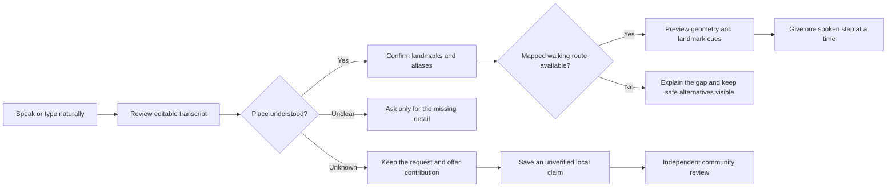
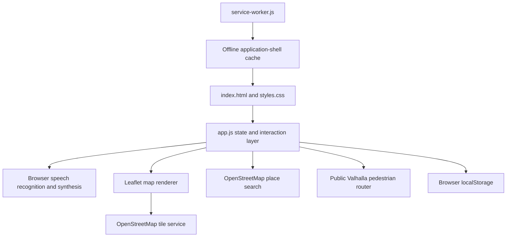

# kidhr

> **Maps know coordinates. People know places.**

kidhr is a voice-first, landmark-based walking navigation project for people who describe places through local names, remembered landmarks, and spoken directions. The first pilot focuses on Amritsar, Punjab.

Someone can ask for a place naturally, such as `Railway station ton Darbar Sahib`. kidhr preserves the spoken wording, resolves known local aliases, confirms what it understood, and presents a walking route when mapped pedestrian data is available.

This repository contains the first interactive PWA prototype. It demonstrates the main product experience across phones, tablets, and desktops. It is suitable for product demos, user-flow testing, and continued development. The shared production backend is intentionally documented as future work rather than presented as complete.

## Project status

| Area | Status |
| --- | --- |
| Amritsar product experience | Interactive prototype |
| Responsive layouts | Implemented for phone, tablet, and desktop |
| Voice input and spoken replies | Implemented through browser speech APIs |
| Railway Station to Darbar Sahib journey | Demonstrable end to end |
| Live pedestrian geometry | Loaded from a public OSM-based router when available |
| Contributions and reviews | Browser-local prototype |
| Shared community database | Planned |
| Authentication and production trust rules | Planned |
| Production field validation | Required before public navigation use |

## Contents

- [Why kidhr exists](#why-kidhr-exists)
- [How the experience works](#how-the-experience-works)
- [Try the complete demo](#try-the-complete-demo)
- [What the first build includes](#what-the-first-build-includes)
- [Technology and architecture](#technology-and-architecture)
- [Project structure](#project-structure)
- [Run locally](#run-locally)
- [Verify changes](#verify-changes)
- [Data, voice, maps, and privacy](#how-the-prototype-stores-data)
- [Deploy to Vercel](#deploy-to-vercel)
- [Current limitations](#current-limitations)
- [Roadmap](#roadmap)
- [Contributing with teammates](#contributing-with-teammates)
- [Troubleshooting](#troubleshooting)

## Why kidhr exists

Many places in India are easier to describe than to address. A local person might say, “Hall Gate ke andar,” “purane cinema de pichhe,” or “paani di tanki kol.” These directions carry useful geographic knowledge, but much of that knowledge is absent from formal address fields.

This creates a last-mile problem for delivery workers, auto and e-rickshaw drivers, pilgrims, tourists, first-time visitors, and anyone trying to reach a home or small business in an unfamiliar area. People often solve it through repeated calls, approximate pins, or asking several strangers along the way.

kidhr explores a different interaction model. The person describes the destination naturally. The system identifies landmarks and aliases, confirms uncertain details, uses mapped walking data where it exists, and keeps community knowledge clearly separated by trust status.

The initial Amritsar pilot keeps the problem concrete. It focuses on multilingual landmark navigation around familiar public places while leaving room for wider city and rural expansion later.

## How the experience works



The route preview and navigation flow only draw geometry returned by the pedestrian-routing service. When routing is unavailable, the app keeps the written cues and reports the limitation instead of drawing a guessed line.

## Try the complete demo

The strongest first-build path starts with this mixed Punjabi-English request:

```text
Railway station ton Darbar Sahib
```

1. Open Home and submit the request by typing it or holding the microphone control.
2. Review the editable transcript and recognized landmarks.
3. Notice that `Darbar Sahib` resolves to the mapped Harmandir Sahib place.
4. Confirm the request to open Route Preview.
5. Wait for live pedestrian geometry or read the visible fallback status.
6. Start walking mode and use Repeat, Next, Galat raasta, and Stop.
7. Open Teach to save a local route claim.
8. Open Verify to see why route authors cannot approve their own claims.
9. Search Landmark Memory for `Golden Temple`, `Town Hall`, or `Gandhi Gate`.

This journey demonstrates the product idea without requiring an account, API key, or database setup.

## Product principles represented in the prototype

- **Local language is geographic data.** Aliases and colloquial phrases are preserved instead of immediately replaced.
- **Confirmation comes before navigation.** People can edit what the system heard before a route is shown.
- **Ambiguity should stay visible.** Unknown requests remain available for correction or contribution.
- **Mapped geometry earns the route line.** A failed router produces a clear fallback rather than a fabricated path.
- **Community knowledge starts unverified.** A contribution is a claim until independent evidence supports it.
- **Voice always has a visible companion.** Important speech appears as editable or readable interface text.
- **Every state offers a next action.** Typing, retrying, returning, contributing, or choosing a known route remains possible.

## What the first build includes

- First-use language selection for Punjabi, Hindi, and English
- Support for mixed-language and colloquial requests
- Roman, Gurmukhi, and Devanagari presentation controls
- Press-and-hold voice input using the browser Web Speech API
- Editable transcripts and alternative recognized phrases
- Spoken and visible feedback for voice actions
- Alias resolution for names such as `Darbar Sahib` and `Golden Temple`
- A curated Railway Station to Harmandir Sahib demonstration journey
- Live pedestrian geometry requested from OpenStreetMap-based routing
- Step-by-step landmark navigation with repeat, next, stop, and wrong-route controls
- Route sharing through the Web Share API or WhatsApp
- Browser-persisted route contributions and community reviews
- Self-review and duplicate-review rejection
- Searchable Landmark Memory cards
- Offline caching for the application shell
- Responsive mobile, tablet, and expanded desktop layouts
- Static Vercel deployment configuration

All seven product areas are visibly reachable through the interface.

1. Home and Find
2. Voice and Transcript
3. Route Preview
4. Active Navigation
5. Contribute
6. Verify
7. Landmark Memory

## Technology and architecture

The prototype deliberately uses a small static architecture so teammates can run and deploy it without installing a framework toolchain.

| Area | Current implementation |
| --- | --- |
| Interface | HTML, CSS, and browser JavaScript |
| Mapping | Leaflet with OpenStreetMap tiles |
| Place search | User-triggered OpenStreetMap Nominatim search within Amritsar |
| Pedestrian routing | Public Valhalla OpenStreetMap service |
| Speech input | Browser Web Speech API |
| Spoken replies | Browser Speech Synthesis API |
| Pilot persistence | Browser `localStorage` |
| Offline support | Service worker and web app manifest |
| Hosting | Static Vercel deployment |

Leaflet and web fonts are loaded from public CDNs. Maps, live routing, fonts, and first-time asset loading therefore need an internet connection.

### Runtime architecture



There is no application server in this version. The browser owns the interaction state and talks directly to public map and routing services. That makes the prototype quick to run, but it also explains why shared community records, strong identity, moderation, and trusted verification require the planned backend.

## Project structure

```text
kidhr/
├── index.html              Main application markup and seven screens
├── styles.css              Responsive layout and visual system
├── app.js                  Application state, voice, maps, flows, and storage
├── service-worker.js       Application-shell caching
├── manifest.webmanifest    PWA metadata and installation settings
├── icon.svg                Application icon
├── vercel.json             Vercel framework and SPA routing configuration
├── package.json            Local commands, with no runtime dependencies
├── scripts/
│   └── check.mjs           Structural project check
└── README.md               Project and contributor guide
```

### Where teammates should make changes

| Change | Main file | Related checks |
| --- | --- | --- |
| Screen content or controls | `index.html` | Confirm all target IDs still exist |
| Colors, spacing, or breakpoints | `styles.css` | Test phone, tablet, and desktop widths |
| Voice, navigation, parsing, or storage | `app.js` | Run syntax check and complete the affected flow |
| Landmark or alias seed data | `app.js` | Verify names and coordinates against a reliable map source |
| Offline shell files | `service-worker.js` | Increment the cache name when necessary and retest updates |
| PWA name, icon, or install behavior | `manifest.webmanifest` and `icon.svg` | Test from an HTTPS deployment |
| Vercel routing or headers | `vercel.json` | Validate JSON and create a preview deployment |
| Structural verification | `scripts/check.mjs` | Run `npm run check` |

The current JavaScript is intentionally contained in one file for a small prototype. As the backend and supported journeys grow, split data, speech, maps, storage, and screen controllers into focused modules rather than continuing to expand one global script.

## Requirements

- A modern browser, preferably current Chrome or Edge for the broadest speech-recognition support
- Node.js 18 or newer for the project check and optional local server
- An internet connection for map tiles, live routing, CDN assets, and browser speech services
- Microphone permission when testing voice input

No `npm install` is required because the project has no package dependencies.

## Run locally

From the repository directory, use either option below.

### Option 1 using `npx`

```bash
cd /path/to/kidhr
npx serve .
```

The first run may ask permission to download the `serve` utility. Open the local URL printed in the terminal.

### Option 2 using Python

```bash
cd /path/to/kidhr
python3 -m http.server 3000
```

Open `http://localhost:3000`.

Using a local server is important. Opening `index.html` directly through a `file://` URL can prevent microphone, service-worker, and routing behavior from working correctly.

Stop either local server with `Ctrl+C`.

## Verify changes

Run the project check before sharing a branch or deployment.

```bash
npm run check
```

The expected output includes:

```text
PASS: JavaScript syntax and all seven reachable screens verified.
```

The command checks JavaScript syntax, verifies that all seven screens exist, and confirms that required application files are present. It does not replace browser testing.

### Manual test checklist

1. Choose each first-use language and confirm the setting persists.
2. Enter `Railway station ton Darbar Sahib` and confirm the transcript.
3. Edit part of the transcript and use an alternative recognized phrase.
4. Open the route preview and confirm the map or honest routing fallback appears.
5. Start navigation and test Repeat, Next, Galat raasta, and Stop.
6. Hold a microphone control, speak, and release it to stop recording.
7. Deny microphone permission and confirm typed input remains available.
8. Create a contribution and refresh the page to confirm local persistence.
9. Try to review your own contribution and confirm it is rejected.
10. Review a seeded community route twice and confirm the duplicate is rejected.
11. Search Landmark Memory using `Darbar Sahib`, `Golden Temple`, and `Town Hall`.
12. Test widths around 390 px, 768 px, 1024 px, and 1440 px.
13. Test route sharing and PWA installation on an HTTPS deployment.

## How the prototype stores data

The first build stores pilot state in browser `localStorage`.

| Key | Purpose |
| --- | --- |
| `kidhr-lang` | Selected reply language |
| `kidhr-script` | Selected writing system |
| `kidhr-user` | Random local browser identifier |
| `kidhr-welcomed` | First-use completion |
| `kidhr-large-text` | Large-text preference |
| `kidhr-claims` | Locally contributed route claims |
| `kidhr-reviews` | Reviews submitted from the browser |

This data remains on one browser profile. It is not synchronized between devices or users. Clearing site data removes it.

The local identifier only supports prototype self-review and duplicate-review demonstrations. It is not authentication and must not be treated as a production security boundary.

## Voice and privacy behavior

Voice recognition is started only while a microphone control is held. Releasing or cancelling the press stops recognition. The application does not save raw audio.

Speech processing behavior depends on the browser and operating system. Some browsers may send audio to their speech provider. Production privacy documentation should describe the chosen speech provider before a public pilot.

When voice recognition is unsupported or permission is denied, the interface keeps typed input available. Confirmed text remains editable.

## Maps and routing behavior

Known landmarks use their seeded map coordinates. Other typed origin and destination names are searched in OpenStreetMap within the Amritsar area. When a search returns multiple matches, the user chooses the correct pins before routing. A confirmed pair is sent to the public Valhalla service for pedestrian geometry and turn instructions. The Railway Station to Harmandir Sahib journey remains the curated demo route.

The application draws a path only after the routing service returns mapped geometry. If live routing fails, it clearly reports that no path was drawn; the curated demo can still show its stored text directions. If place search fails or returns no match, the request stays visible so the user can edit it or contribute the place. The app does not invent entrances or route geometry.

Public routing and tile services can be unavailable or rate-limited. A production deployment should use a supported routing provider or a maintained Amritsar pedestrian-routing service with appropriate capacity and usage terms.

## Deploy to Vercel

Import the repository into Vercel and use these settings.

| Setting | Value |
| --- | --- |
| Framework Preset | Other |
| Root Directory | `./` when this repository is imported directly |
| Build Command | Leave blank |
| Output Directory | Leave blank |
| Install Command | Leave blank or use the automatic default |
| Environment Variables | None for this prototype |
| Production Branch | `main` |

Select **Deploy** after reviewing the settings. Vercel serves the repository as a static site and applies the SPA rewrite and service-worker cache header from `vercel.json`.

After deployment, test microphone permission, maps, routing, sharing, refresh behavior, and installation from the generated HTTPS URL.

## Current limitations

The following capabilities are outside the current first build.

- Shared database persistence
- User accounts and secure authentication
- PostGIS landmark and route storage
- Row-level security
- Server-side validation and rate limiting
- Server speech-to-text fallback
- Shared multilingual alias management
- Photo evidence and moderated reports
- Real independent multi-user verification
- GPS progress tracking and off-route detection
- Background navigation and reliable wake-lock handling
- A full Amritsar landmark and curated-route dataset
- Production monitoring and analytics

The interface demonstrates contribution and verification behavior locally. It does not claim that a local vote makes a route Community Verified.

## Recommended production architecture

The next production phase should retain the current interaction model while moving trust-sensitive operations to server-controlled services.

- Use Supabase Auth for contributors and reviewers.
- Store landmarks, aliases, routes, ordered steps, claims, reviews, disputes, and profiles in Postgres with PostGIS.
- Apply row-level security and server validation for all writes.
- Reject self-reviews and duplicate votes in database constraints or trusted server functions.
- Keep API keys and speech-provider credentials on the server.
- Discard raw audio after transcription.
- Validate route geometry against pedestrian-accessible OSM ways.
- Require two independent positive confirmations, including one field-based review, before Community Verified status is possible.
- Add moderation and closure-report workflows before accepting public contributions.
- Cache reviewed route data for reliable low-connectivity use.

## Roadmap

The roadmap below describes a practical path from this interaction prototype to an Amritsar pilot. It is a planning guide rather than a promise that the listed work is already implemented.

### Phase 1 — strengthen the prototype

- Replace hard-coded request matching with a tested structured intent parser.
- Add focused ambiguity choices for places with similar names.
- Expand verified Amritsar landmarks and multilingual aliases from traceable map sources.
- Add more curated journeys only after checking pedestrian geometry and landmark cues.
- Add automated interaction and responsive-layout tests.
- Move CDN assets into a controlled build or approved hosting setup where appropriate.

### Phase 2 — shared pilot backend

- Add Supabase Auth, Postgres, PostGIS, and row-level security.
- Create versioned schemas for landmarks, aliases, routes, steps, claims, reviews, and disputes.
- Move parsing, contribution, verification, and reporting writes behind validated endpoints.
- Add rate limiting, moderation tools, audit history, and safe photo evidence.
- Add server speech-to-text fallback while discarding raw audio after transcription.

### Phase 3 — field-ready Amritsar pilot

- Validate landmarks, entrances, and walking connections with local field testers.
- Test regional accents, code-switching, noisy streets, and low-connectivity recovery.
- Implement GPS progress, off-route detection, valid rerouting, and wake-lock behavior.
- Measure route completion, clarification quality, correction frequency, and user-reported trust.
- Publish privacy information and community contribution guidelines.

### Phase 4 — responsible expansion

- Review pilot evidence before adding another city or rural region.
- Build local moderation and alias-review processes for each new area.
- Preserve historical names without describing demolished landmarks as currently visible.
- Keep trust status, evidence, and disputes understandable to everyday users.

## Contributing with teammates

Before implementation, agree on the problem, value, scope, and expected behavior for each change.

Create a focused branch from the latest `main` unless the team has explicitly agreed to work directly on `main`.

```bash
git switch main
git pull origin main
git switch -c feat/short-description
```

Use `fix/short-description` for bug fixes. Keep unrelated edits out of the same branch.

Before opening a pull request:

1. Run `npm run check`.
2. Complete the relevant manual browser tests.
3. Test mobile, tablet, and desktop layouts when changing the interface.
4. Describe actual passes, failures, warnings, and untested behavior honestly.
5. Update this README when setup, architecture, storage, or deployment behavior changes.

Prefer concise Conventional Commit messages when practical.

```bash
git add .
git commit -m "feat: add landmark ambiguity choices"
git push -u origin feat/short-description
```

## Troubleshooting

### The page has no styling

Confirm the app is running through a local HTTP server and that `styles.css` returns successfully. On Vercel, confirm the repository root contains `index.html`, `styles.css`, and `vercel.json`.

### Voice input does not start

- Use `localhost` or an HTTPS deployment.
- Check browser microphone permission.
- Try current Chrome or Edge.
- Confirm another application is not exclusively using the microphone.
- Continue with the editable text input when speech recognition is unavailable.

### The map is blank

- Confirm the device is online.
- Check whether browser extensions block OpenStreetMap or CDN requests.
- Reload once after allowing network access.
- Continue with the visible route steps if tiles remain unavailable.

### The route line does not appear

The public Valhalla endpoint may be unavailable or rate-limited. The curated demo keeps its stored text directions visible, while other requests offer a route retry. Do not replace missing geometry with a hand-drawn path.

### A contribution disappeared

Contributions are stored only in that browser profile. Private browsing, clearing site data, changing browsers, or changing devices removes access to them.

### A service-worker change looks stale

Close all open tabs for the site, reopen it, and reload. During development, browser developer tools can unregister the existing service worker and clear site storage.

## Attribution

Map data and tiles are provided by OpenStreetMap contributors. Live pedestrian geometry is requested from the public Valhalla OpenStreetMap routing service. Leaflet provides browser map rendering.

Historical and colloquial place-name relationships should be reviewed with knowledgeable Amritsar community members before production publication.
